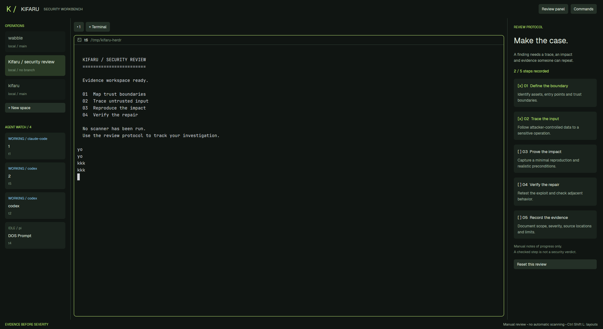

# Kifaru Security for Herdr

A native security review workbench with live agent navigation, terminal tabs and per-space review progress.



See [RECIPE.md](RECIPE.md) for the complete reconstruction brief, behavior, installation and acceptance checks.

Copy `layouts/kifaru-security.json` and `mods/kifaru-security/` into your Herdr app home without overwriting existing names. Then run:

```sh
herdr-app check ~/.config/herdr-app/mods/kifaru-security
herdr-app do layout.switch '{"name":"kifaru-security"}'
```

The custom mod makes no network requests, executes no programs and reads no external files. Checkmarks represent manual progress, not scan results.

Validated with the installed Herdr native checker and live rendering (no runtime errors). Preview is an actual Herdr capture with demonstration terminal text. Interactive acceptance checks and blocked/done agent lifecycle transitions still require hands-on verification.
