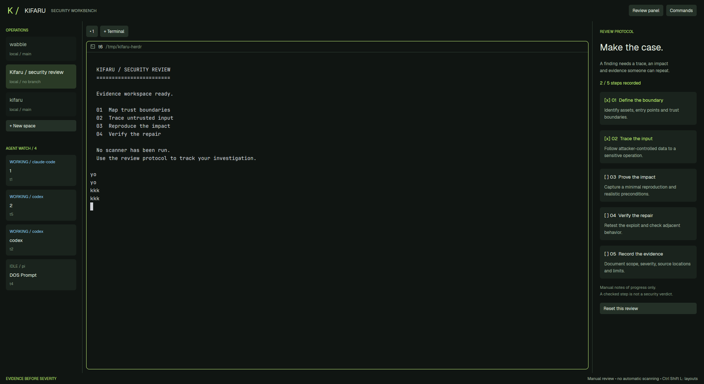

# Kifaru Security

A quiet security review workbench for Herdr: charcoal green surfaces, lime wayfinding, an agent watch queue at left, live terminals in the middle, and a five-step evidence protocol at right. It helps a reviewer keep the investigation and its proof together without inventing findings or scan results.

## What you see

Keep the native system title bar. Below it, a 58px brand bar displays a lime `K /`, KIFARU, SECURITY WORKBENCH, and Review panel and Commands buttons. A 30px footer says EVIDENCE BEFORE SEVERITY and explains that this is manual review.

The middle is a resizable row: a 224px operations sidebar (180–360px), a flexible terminal workspace with 10px padding and 8px gaps, and a 304px review rail (270–420px). Separate regions with 1px borders. The workspace has a 36px tab strip. Every terminal, including a lone terminal, has an 8px rounded frame, 1px border, lime focus border, 8px split gaps and a 30px shipped pane header.

Use graphite as the base theme; override background/canvas to #101512, chrome #141b17, surface #1a231d, raised #243027, border/hover #304035, accent/done #c1ef79, foreground #e6eee4, muted #a6b6a6, dim/idle #819580, selected #2a3a26, working #8fc9ef and blocked #f0ad70. Use bundled Geist for UI and JetBrains Mono 14px for terminals. Brand text is 17px, K / is 24px; section labels 10px, normal UI 12–14px, review headline 25px. Respect theme() so theme overrides work.

The sidebar lists every live space: name, machine (local when null), branch (no branch when absent). Highlight the active space. Below New space, show AGENT WATCH and its live count, then cards containing status/app, tab name and terminal address. The rail reads REVIEW PROTOCOL, Make the case., an evidence reminder, and the checked count. Five clickable cards contain:

1. Define the boundary — Identify assets, entry points and trust boundaries.
2. Trace the input — Follow attacker-controlled data to a sensitive operation.
3. Prove the impact — Capture a minimal reproduction and realistic preconditions.
4. Verify the repair — Retest the exploit and check adjacent behavior.
5. Record the evidence — Document scope, severity, source locations and limits.

End with a manual-progress disclaimer and Reset this review.

## How it behaves

Sort agents by blocked, done, working, idle; keep source order within each group. Show uppercase status labels: blocked orange, done lime, working blue, idle muted green. These are agent lifecycle states, never vulnerability severity. Done means finished while unseen and becomes idle when viewed, according to Herdr. With no agents, show an explicit empty state.

Click a space to select it, an agent to focus its terminal, a tab to select it, New space to create a space, or + Terminal to create a tab. Review panel toggles the right rail. Commands opens the command palette. Controls and cards brighten on hover. Splits and columns resize natively; panes can move with Herdr's grip. The native title bar handles the window.

Click a review card to toggle its [ ] / [x] marker and lime checked title. Persist the five booleans separately for each space; switching spaces restores that space's progress. Reset clears only the current space. With no space, explain that one must be selected and make checklist/reset clicks harmless. Checked items record human progress, not a security verdict. No scanning, command execution or network requests occur in the custom mod. No custom keys are installed; the footer advertises Herdr's default Ctrl Shift L layout cycling.

## Built from

Create layouts/kifaru-security.json and mods/kifaru-security/{main.js,mod.json}; mod.json is {"place":"none"}. Root is a column: brand block; body row containing sidebar block, work column (tabs block and active-tab block), review block; footer block. All named blocks except active-tab use the single custom mod kifaru-security with props.role set respectively to bar, nav, tabs, review, footer. Unknown/missing role renders review. Active-tab content is {"tab":"active","pane":...}. The only shipped mod dependency is pane, used as the terminal header. Do not copy or edit shipped mods.

The custom main.js default-exports a View subclass. Build native GPUI with div from gpui-kit and h_flex/v_flex from gpui-base. No HTML, CSS or Node. Import spaces, agents, focused, props, theme, run, shared, setShared, setAgentOrder from herdr (focused is presently unused). Read props with optional chaining because the checker renders without props. Derive all live lists on render; do not poll. Call setAgentOrder with the sorted agent addresses. Actions call space.select {id}, space.new, agent.focus {terminal}, tab.select {id}, tab.new, layout.toggle {id:"review"}, app.palette. Store review state under `kifaru-security.review.<space.id>` through shared/setShared; spread the latest stored object on every toggle so other copies' changes are respected. No stored cx, timers, background tasks, external files, programs or network access are needed. The shipped pane header has its own standard pane controls.

There is no external art: the mark is text. Set the layout preview to mods/kifaru-security/preview.png and include a copy there for Herdr's settings gallery, in addition to the required root preview.png. Capture the actual rendered layout using herdr-app shot. The example terminal text in the screenshot is demonstration content, not findings, and is not part of the layout or automatically installed.

## Watch out

Herdr's checker supplies null props: props().role failed during this build; props()?.role fixes it. The checker exercises the default review role once, so also switch the live layout and inspect status and the screenshot to exercise other roles. The initial sandbox blocked Wayland access; checks needed display access.

Use a custom tab strip: the shipped tabs mod exposes Files/Changes controls for panels this tree does not contain. Existing keybindings remain the user's. Lists and the review rail scroll; the tab strip is a simple horizontal row and many long tab names can overflow. Approximately 1000px window width is a practical baseline with both rails open; hide the review rail or resize columns for narrower windows. Empty branches are labeled no branch, not treated as an error. No agent status means no agent card. User theme overrides may alter the pictured colors.

Shared state is local to the Herdr screen's app home, not a collaborative case database. It is keyed by space id, has no evidence attachments and may outlive a deleted space. A reset is immediate with no confirmation. There are no inactive placeholder controls. The footer's key hint assumes default Herdr keys. This layout neither enforces security boundaries nor restricts terminal commands.

For installation, copy the layout and mod into the matching directories of the Herdr app home. Never overwrite a name collision: rename the layout, mod directory, references and preview path together. Leave root RECIPE.md and preview.png in the distribution. Keep the mod's preview copy. No dependencies or key merging are needed.

## Done when

- herdr-app check <folder>/mods/kifaru-security passes.
- After installation, herdr-app do layout.switch '{"name":"kifaru-security"}' succeeds; herdr-app status reports no errors.
- All five custom roles render as described, and herdr-app shot preview.png produces an actual window capture with readable rails and terminal framing.
- Space, agent and tab clicks select their explicit targets; new-space, new-tab, palette and review toggle controls perform their stated actions.
- Checking a step changes its marker/count; switching spaces isolates progress; switching back restores it; reset affects only that space. An empty world remains usable.
- Working, blocked, done and idle use their mapped colors and queue order when those states are reported by real agents. Verify remaining lifecycle states when available; never fabricate them for a passing screenshot.
- The distribution contains the layout, mod, this reconstruction brief, and preview.png together, and its public GitHub repository carries topic herdr-layout.
